# dsh-memj — Memory That Follows Your Projects

English | [中文](README.md)

A **DeepSeek Harness memory plugin**.

## The biggest selling point: build *your own* memory system

It gives you read/write tools with **enough granularity**, and **hard validation** that
protects your data and keeps the system stable. The **maximum freedom** is left to you —
everything below can be edited right in the UI, **without changing a single line of code**:

| What you can change | What it changes |
|---|---|
| **Knowledge types** | How many kinds of knowledge there are, what they're called, when to use each |
| **Document templates** | What a memory looks like: which sections exist, what each one should contain |
| **All prompts** | How the model is instructed, and what the protocol says |

> **An example**: I never built "async knowledge capture via a subagent".
> But you can change the tool protocol / prompts so the model **forks a subagent to capture
> knowledge before wrapping up** — a **systemic behavior change**, still with zero code.
> (One step further, and you'd expose hook APIs as tools.)

**In one line: you can use this memory system to build a memory system of your own.**

## Core design

- **A project is the memory entity** — a **project document whose conventions you design freely**
  (a handoff by default). It is the single entry point for that project, reused across
  **sessions and instances**;
- **Handoff is the main path** — compress one round of work into the starting point of the next;
  the compression is **controllable, editable, and archivable**;
- The plugin **identifies which project a session belongs to**, and **binds captured knowledge
  to that project**;
- It looks for **commonality** across your real multi-project work and **promotes** general
  knowledge to a **theme** or **global** level;
- The traditional **tag / kind / search** machinery still works, and can be layered on top.

⇒ ⭐ **Knowledge is clustered and pre-filtered by the most natural unit there is:
the project — and the way you actually work.**

> The whole library is **one directory** (`~/.dsh-memj/`) — **copy it and you've migrated**.
> Project documents and knowledge are all **Markdown**: readable, diffable, openable in any editor.

---

## Quick start

⭐ **Recommended: install it right inside the DSH UI** — **Plugins** page in the left sidebar →
**"Add plugin"** in the top right → type **`dsh-memj`** → **Install**.

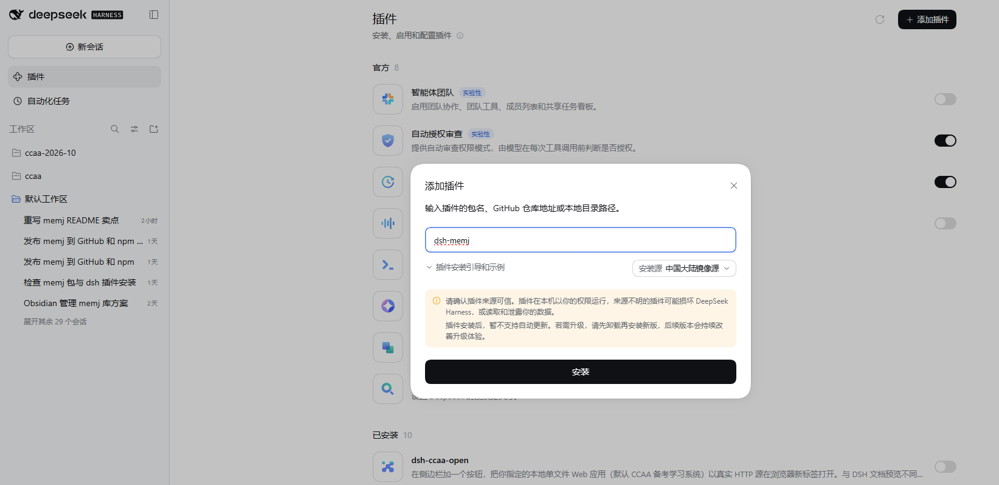

**No commands, no restart** — the sidebar entry is there as soon as it finishes.
(Pick whichever install source matches your network.)

Or use the CLI (equivalent):

```bash
dsh plugin --profile web add dsh-memj
```

- 📦 npm: <https://www.npmjs.com/package/dsh-memj> (`pnpm add dsh-memj` works too)
- 🐙 GitHub: <https://github.com/jojoman2024/dsh-memj>
- ⚠️ **Requires DSH `0.2.0-rc.2`** (that version is published under the **`@next`** tag on npm;
  `latest` is the older `0.1.0-rc.6`) — see the [Install](#install) section.

---

## Table of contents

**Selling point and design core**:

- [The biggest selling point: build your own memory system](#the-biggest-selling-point-build-your-own-memory-system)
- [Core design](#core-design)
- **Knowledge follows projects** — the project is the **main line**: every piece of knowledge
  belongs to a project, and is then reused along themes / global / kinds / tags
- **Handoff is the main path** — the project document is itself the handoff document: it compresses
  one round of work into the next starting point, controllably and editably
- **Everything is open** — document templates, knowledge types, and all prompts are editable in the UI

The rest:

- [Ownership: three tiers and promotion](#ownership-three-tiers-and-promotion)
- [What a project document looks like](#what-a-project-document-looks-like)
- [How knowledge is stored and found](#how-knowledge-is-stored-and-found)
- [Four ways to use it](#four-ways-to-use-it)
- [Three recall mechanisms](#three-recall-mechanisms)
- [The human-facing panel](#the-human-facing-panel)
- [Install](#install)
- [What the library looks like](#what-the-library-looks-like)
- [Configuration](#configuration)
- [Boundaries and known limitations](#boundaries-and-known-limitations)
- [Development](#development)

---

## ① Knowledge follows your projects

**This is the design core of the whole plugin.**

Knowledge is captured along the fundamental logic of projects, and then promoted to
theme-level or global-level knowledge according to what projects have in common.
**It clusters knowledge the way you naturally work, so it stays close to your actual needs.**

**The project is the main line**: every piece of knowledge belongs to a project, and the
project document is its single entry point:

```
        ┌──────────────────────────────────────────────┐
        │  Project = the main line of memory            │
        │                                               │
        │   HANDOFF-<project>.md                        │
        │   ├─ narrative: how this project got here     │
        │   └─ knowledge index: one line per entry      │
        └──────────────────────────────────────────────┘
             │                    │                 │
   promote commonality │  refine further │      also tag with
             ▼                    ▼                 ▼
   theme (cross-project) → global (always injected)   kind · tags
```

⭐ **But the main line is not the only retrieval dimension** — one piece of knowledge carries:

| Dimension | Role |
|---|---|
| **project** | The main line. Which project it was produced in |
| **theme** | Cross-project reuse: this knowledge **is useful to other projects too** |
| **global** | Cross-theme, injected unconditionally |
| **kind** | Is it a fact / trap / how-to / decision / archive |
| **tags** | Free-form words that **score alongside title and description** |

⇒ So the model can search "**along the project**" (what does this project contain?),
or sweep "**by topic**" across everything (anything about "pnpm/release", whichever project it
came from). **Both paths work**, and they compose (e.g. "under theme X, find things tagged Y").

### Three views, three kinds of questions

**① Knowledge — what one entry looks like**

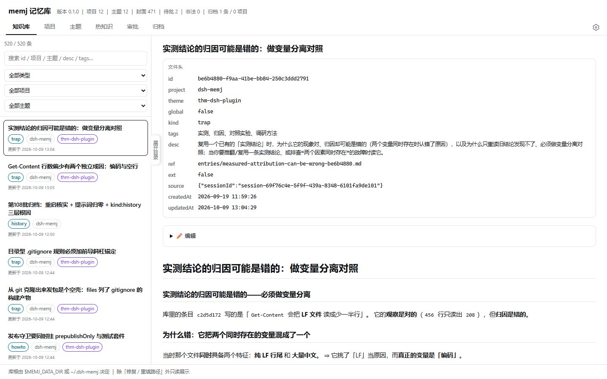

An entry's ownership can be edited afterwards.

**② Projects — the main line of memory**

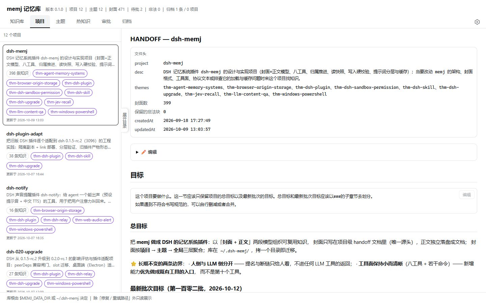

Ownership is editable here too. Each project document's per-section writing conventions are
editable in the document itself, including its compaction and archiving rules.

**③ Themes — the cross-project line**

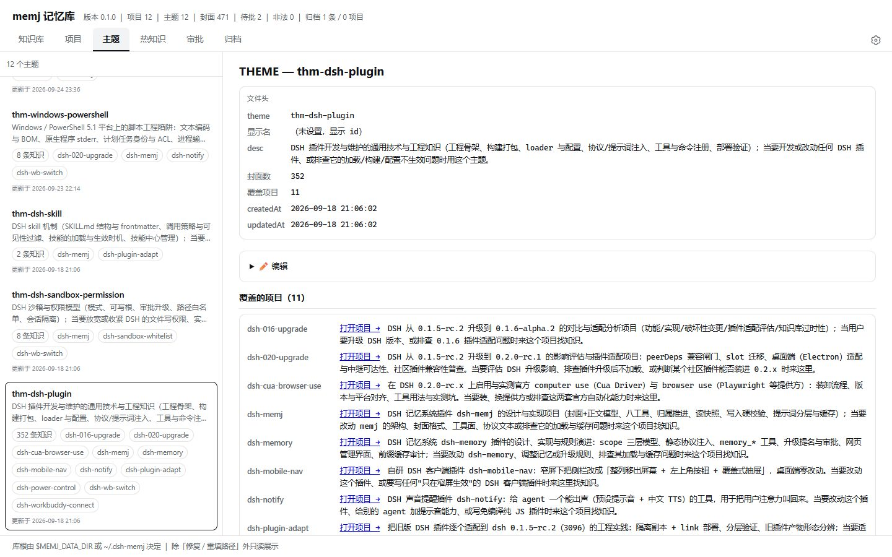

When starting a new session you can hand off the themes related to a project, pulling in their
general knowledge and key context.

**One project document per project** — it is that project's **memory hub**:

- To continue a project in a new session, reading **this one document** is enough — no need to
  guess which keywords to search;
- Every entry hangs under some project, and **the index lives inside that project document**
  ⇒ walk down the project and the knowledge comes with you.

**How it differs from "one big flat knowledge base"**:

| | Flat knowledge base | memj |
|---|---|---|
| Main line | None; keywords only | **Projects** — definite ownership, nothing floats loose |
| Entry point | You must think up keywords first | **Knowledge is clustered by project**, narrowing recall to what you actually need |
| Another angle | — | **Themes / tags sweep sideways**; both paths work |
| New session / new machine | Context must be rebuilt | **Pick it back up along the project** |

⭐ **The one-line test**: *can you pick the context back up along the project, on a different
machine and in a different session?* If yes — that's the effect it's after.

⚠️ **Why the project is the main line instead of organizing purely by topic**: topics overlap,
get renamed, and are hard to keep at a consistent granularity. **Topics alone can't hold things
in.** A finished piece of work keeps growing new related topics. But **a project has boundaries**:
done is done. ⇒ The main line is responsible for **holding things in**; themes, tags, and keywords
are responsible for **fishing things out**.

---

## ② Handoff: compressing one round of work into the next starting point

**Handoff is the plugin's main path.**

The problem it solves: **how to make compression of an old window controllable and archivable,
and how to let a new window start without re-explaining the background.**

Say "**do a handoff**" or type `/memj-handoff`. It guides the model to land this round's output
as two things:

| Where it lands | What it is | For whom |
|---|---|---|
| **The project document** | This round's progress, the traps hit, the decisions made | **Whoever picks it up next (human or model)** |
| **Knowledge entries** | Reusable conclusions: what to do the next time the same problem shows up | **Any future retrieval or injection** |

⭐ **Why this instead of "let the model write a summary"**:

| | A throwaway summary | A memj handoff |
|---|---|---|
| Where it goes | In the chat log, unreachable | **The project document, at a definite place** |
| What goes in | Whatever the model improvises | **Decided by conventions you wrote** (what each section holds) |
| How it's used later | You have to remember it exists | **A new session just reads the project document** |
| Can it be lost | Compaction may drop it | **Landed as a file, never compacted** |
| Can it be edited | No | **Plain Markdown — edit it directly** |
| Does it grow forever | — | **It has an archiving mechanism** (verbatim, not lossy summarization) |

> ⭐ **It is essentially a deliberate compression** — turning a million-token round into a few KB
> of "what the next round actually needs to know". But **this compression is controllable,
> editable, and archivable.**

- **Controllable**: what the compression looks like is **decided by the conventions you write in
  the project document** (which section keeps what, at how many characters is it time to tidy).
- **Editable**: the result is plain Markdown — change it directly, and the next handoff follows
  your edit.
- **Archivable**: when a project document grows too long, the handoff moves the earliest sections
  **verbatim** into one `history` archive entry, leaving a **one-line pointer** in place
  (full id + one-line topic) —
  ⭐ **so compression can go on indefinitely while not a single character of the original is lost,
  and it can be read back by id at any time.**

⚠️ `history` archives **still live in the library, are visible on the knowledge page, and are
readable by id** — but they **do not participate in retrieval** (both search and hot-knowledge
injection skip them). They don't answer "what should I do next time"; they only preserve
"what was actually written back then".
⭐ If you file a superseded original under **any other kind**, it *will* participate in retrieval
(usually not what you want).

> 💡 This is the key difference from "let the model summarize":
> **a summary is lossy and you can never check it afterwards; an archive is lossless and its
> pointer always reaches the original.**

**It is a handoff between the human and the model at the same time**: you can open the project
document whenever you like to see what it recorded, and fix it directly if it's wrong —
**memory is not something you're locked out of**.

**You don't have to do a full handoff**: if you only want to capture knowledge without touching
the project document — or the reverse, only update the document — those can be done separately
(see [Four ways to use it](#four-ways-to-use-it)).

---

## ③ Everything is open: templates, types, and prompts are all yours

memj opens up three things that **should have been your call all along**. They map exactly onto
"what a memory looks like", "how many kinds of knowledge there are", and "how the model is
instructed".

### a) Document templates and writing conventions — what a memory looks like

**Section names, how many sections, and what each one is for** are all up to you:

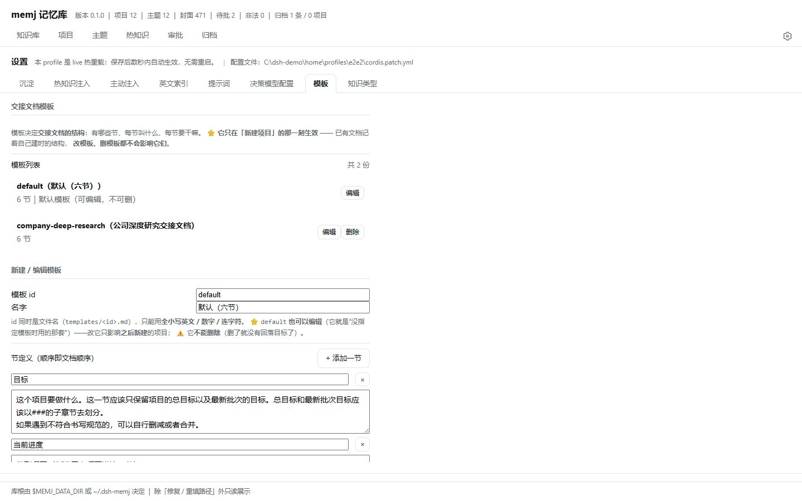

- A template **only takes effect at the moment a project is created**; existing projects remember
  their own structure, and **changing or deleting a template does not affect them**.
- ⚠️ **Section names are not copy — they are a program protocol**: reading a document, rebuilding
  its skeleton, and collecting stats all key off section names.
- ⭐ **The convention block under each section heading is "what this section should contain"**
  (copied from the template when the project is created). The model receives it when reading the
  document and **writes accordingly**;
- ⭐ **Conventions are editable in place**: every convention block on the project detail page has
  an "edit" entry.

⇒ You can reshape the project document to **your own** way of working: research projects can use
"company profile / competitive landscape", engineering projects "interface contracts / trap log".
**Archiving rules go here too** (e.g. "once this section passes 20000 characters, move the
earliest subsections into a `history` archive").

### b) Knowledge types — how many kinds of knowledge there are

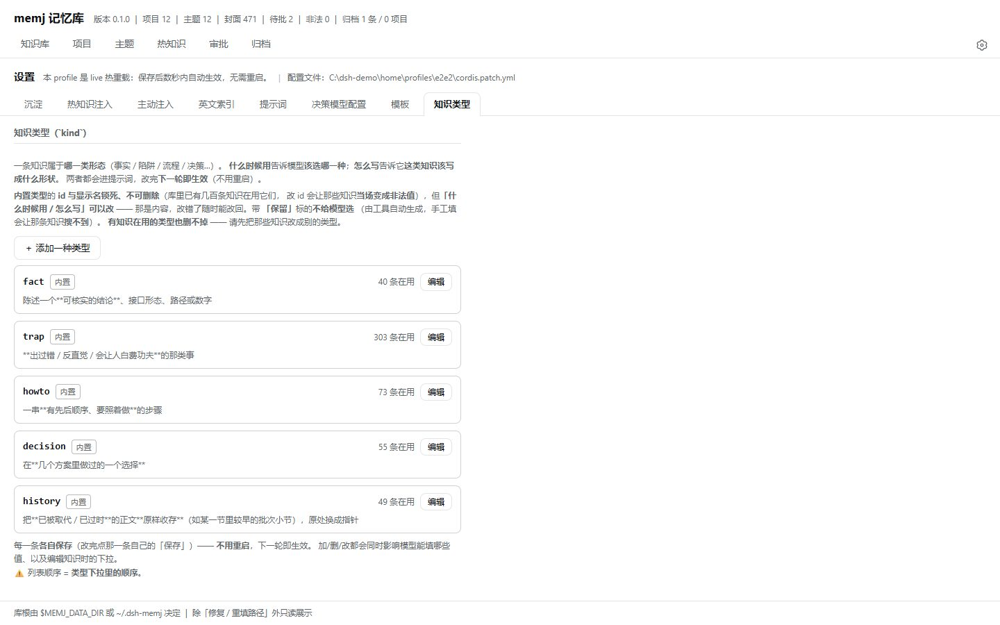

Which shape a piece of knowledge has **is decided by your vocabulary**. Five are built in:
`fact` / `trap` / `howto` / `decision` / `history` (archive).

Changing it **affects three places at once**: which values the model may pass (tool parameters),
the dropdown when writing to the library, and the guidance text for "how this kind should be
written".

- For built-in types the **id and display name are locked** (hundreds of entries already use them);
- "When to use it / how to write it" **are editable**, and can be reverted at any time.

### c) Prompts — how the model is instructed

**Every piece of text written to the model** — the protocol, the usage guidance, the descriptions
of all 11 tools, command text, and the various internal prompts (scoring, tag normalization,
translation, template-writing guidance) — **is editable**:

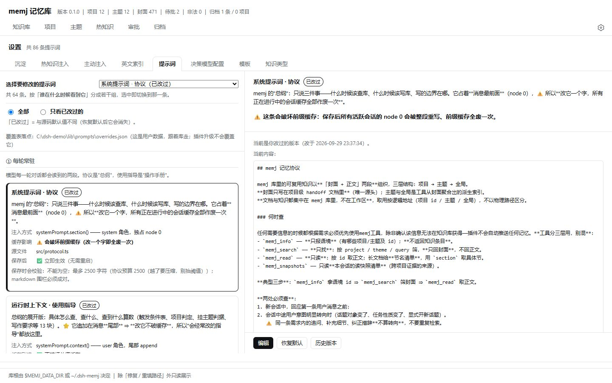

| Feature | Notes |
|---|---|
| **86 entries, 64 of them editable** | Grouped by "**who sees this, and when**", each group with a one-line explanation |
| **Takes effect immediately** | Stored in the library; an in-memory overlay overrides the source defaults (command descriptions excepted) |
| **Revert to default at any time** | Every entry can be restored to the source value in one click |
| **Write back to source** | Make a temporary overlay **permanent in the source**, becoming the new default |
| **Hard to break** | Length caps; slot validation (a missing or misspelled slot is rejected, and the **available slots are listed**) |

⭐ **Why it matters**: model behavior is **largely determined by prompts**. Handing these to you
means **a user with the inclination and ability can design an objective and let the model
iteratively optimize the prompts — self-evolution of the plugin without changing any code.**

> ⭐ **Prefix caching**: usage guidance goes through `context()` (tail of the message stream) —
> **editing it does not break the cache**. The protocol goes through `section()` (node 0, the very
> front) — **editing it breaks the cache once**; the UI marks this explicitly.
> ⚠️ **Command descriptions are the exception**: they are frozen at registration and **require a
> restart**. The UI labels each entry's hot-reload tier.

---

## Ownership: three tiers and promotion

Knowledge aggregates in three tiers: **project → theme → global**. **Ownership accumulates,
it does not move**: adding a theme to an entry **leaves it a project entry**; joining global
**still hits its original themes** — so it **never "disappears from the project because it was
promoted"**.

```
project    knowledge that only holds for this project   ← the vast majority lives here
   ↓ promote commonality
theme      the cross-project kind (e.g. "DSH plugin development")
   ↓ refine further
global     cross-theme, injected unconditionally
```

⭐ **These three tiers are "main line + reuse", not replacements**:
project answers "where was this made", theme answers "**can other projects use it directly**",
global answers "**should it be carried every single time**". One entry can hit all three.

**Promotion is explicit and reviewable**:

- **To a theme**: declare `theme` when writing, and you **must quote a line from that theme's
  description** as justification (the tool checks whether the quote really appears in the
  description — if it can't be found you get a **warning** to reconsider).
- **To global**: **register a nomination**, which only takes effect once approved on the
  human-side **review page** — **the model cannot approve its own nominations**.

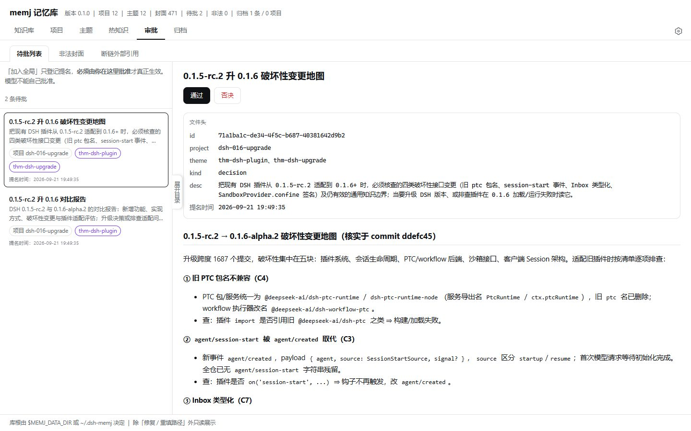

The screenshot above is that **approval gate**: the pending list on the left, the entry's full
ownership and index on the right (`project` / `theme` / `kind` / `desc`), and the full text below
so you can **read it properly before clicking approve / reject**.
⇒ This is a hard boundary of the project: **nominations are for humans only** — the model may
nominate, never approve.

⚠️ **The bar for themes is deliberate**: the test is
**"does this knowledge hold for *other* projects in the scenario that theme's description
describes?"** If it only holds for this project (one specific change, one interface, one set of
measurements) — **don't attach it**. Missing an attachment costs you one row in the theme view
(you can add it later); **a wrong attachment pollutes the theme view every project sees.**
⭐ Conversely: **an entry with no theme is not unsearchable** — it is still findable by project,
filterable by kind, and discoverable by tag.

---

## What a project document looks like

One `HANDOFF-<project>.md` per project. It is a **living document** — a record of how the project
got here, not a snapshot of this moment.

It consists of prose plus a knowledge index that is invisible in the UI:

```markdown
## Goal
> What this section should contain — the model receives this convention when reading
> the document, and writes accordingly
(the content of this section…)

## Current progress
(the content of this section…)

……(section names and count are decided by your template)

---


(at the end of the file: an **index of every entry** under this project, one line each)
- title · description · ownership · kind · id
```

⭐ **The index exists only in the project document (single source)** ⇒ there can never be
"two lists that disagree". Retrieval **reads only these indexes**, never opening any entry's
full text.

---

## How knowledge is stored and found

**One entry = one standalone Markdown file** (`entries/<slug>-<uuid8>.md`).

```
project document (index: title + description + ownership)
        │  this alone is enough to tell "is there anything I need?"
        ▼
full text (a standalone file, read only when you've decided to use it;
           long documents can also be read section by section)
```

⭐ This split resolves the tension between **"searchable" and "read little"**: if they were
combined, every retrieval would read thousands of characters of full text of which the vast
majority is irrelevant this time.

The typical three steps on the model side:

```
memj_info    get the context ids (which projects / themes exist)
  ↓
memj_search  filter knowledge — titles and descriptions only
  ↓
memj_read    fetch full text (long documents return a section list; use `section` for one)
```

**`memj_search` has four filter dimensions that stack freely**:

| Parameter | Role |
|---|---|
| `project` | Filter by owning project — **follow the main line**: "what's in this project?" |
| `theme` | Filter by hit theme — **sweep sideways**: "similar things from other projects" |
| `kind` | Filter by shape (fact / trap / howto / decision / archive), **orthogonal** to the above |
| `query` | Array of search terms, scored over **title / description / tags** (different weights each) |

⇒ For example, "**under theme X, find trap-kind knowledge matching a keyword**" is one call.

**11 tools**, each doing one job:

| Tool | What it does |
|---|---|
| `memj_info` | **Context only** (which projects/themes exist and their ids), **returns no knowledge** |
| `memj_search` | **Find only**: filter by project / theme / kind / query, **titles and descriptions only** |
| `memj_read` | **Read only**: full text by id; long documents give a **section list**, use `section` |
| `memj_snapshots` | Read **this session's read-snapshot list** (the source of cross-project evidence) |
| `memj_handoff` | ⭐ **The main write entry**: narrative + index + create themes + land knowledge |
| `memj_promote` | Advance ownership / edit index fields / project- and theme-level operations |
| `memj_update` | Update the full text and index fields of an **existing** entry |
| `memj_rebuild` | **Rebuild derived layers** (themes / global) from the project documents |
| `memj_template` | Manage document templates (two-phase confirmation) |
| `memj_normalize_tags` | Tag normalization (merge synonyms, drop generic words, add English) |
| `memj_score_turn` | End-of-turn retrospective scoring (called by a subagent) |

> ⭐ **When `memj_read` can't match a section name it returns the section list.** That is design,
> not an error: otherwise you'd be in a deadlock where reading a section requires knowing its
> name, and getting the names requires reading the whole document.

---

## Four ways to use it

### ① Handoff (the main path)

Say "**do a handoff**" or `/memj-handoff` — the project document and knowledge land together.

### ② Capture knowledge only

Just want to record one thing without writing a handoff? Say "**save this to the knowledge
base**". Use `step: 'knowledge'` to land knowledge only; the project narrative is untouched.

### ③ Write / edit only the project document

`step: 'narrative'` updates the document only. `docSection` + `docOp` can **touch a single
section** (`append` / `prepend` / `replace` / `drop`) without rewriting the whole file.

### ④ Just ask the library

The model calls `memj_search` / `memj_read` as needed — **both paths work**:

- **Along the project**: "what traps does the `dsh-memj` project have about releasing?"
- **Sideways by topic**: "**whatever project it's from**, pull up anything about pnpm / bundling /
  publishing"
- **By shape**: "which ones are `trap` kind?"
- **Stacked**: "under the theme 'DSH plugin development', find how-to knowledge matching a keyword"

Slash commands are available too:
`/memj-get-handoff-project`, `/memj-get-handoff-theme`, `/memj-review`.

> ⭐ **Narrative and knowledge are separate**: the project document says "how this project got
> here"; knowledge says "what to do the next time the same problem shows up". The former solves
> **continuity**, the latter **reuse**.

---

## Three recall mechanisms

memj **does not push by default** — it assumes the model will go look. But an LLM's **willingness
to call tools is not reliable**, so there are three **optional** recall channels (all **off** by
default; turn on whichever you want).

### ① Hot knowledge injection — pushing relevant knowledge into context

At the start of a session, the **knowledge relevant to this session** (title + description) is
injected; a **watchdog** then checks whether they're still inside the model's visible window and
**re-injects what was lost, incrementally** (only the missing ones, never the whole batch again).

There are four source layers, each individually configurable:
**user profile / global knowledge / project knowledge / theme knowledge.**
The human-side panel has three views, each answering one question:

**① Live session state — what actually got injected this time**

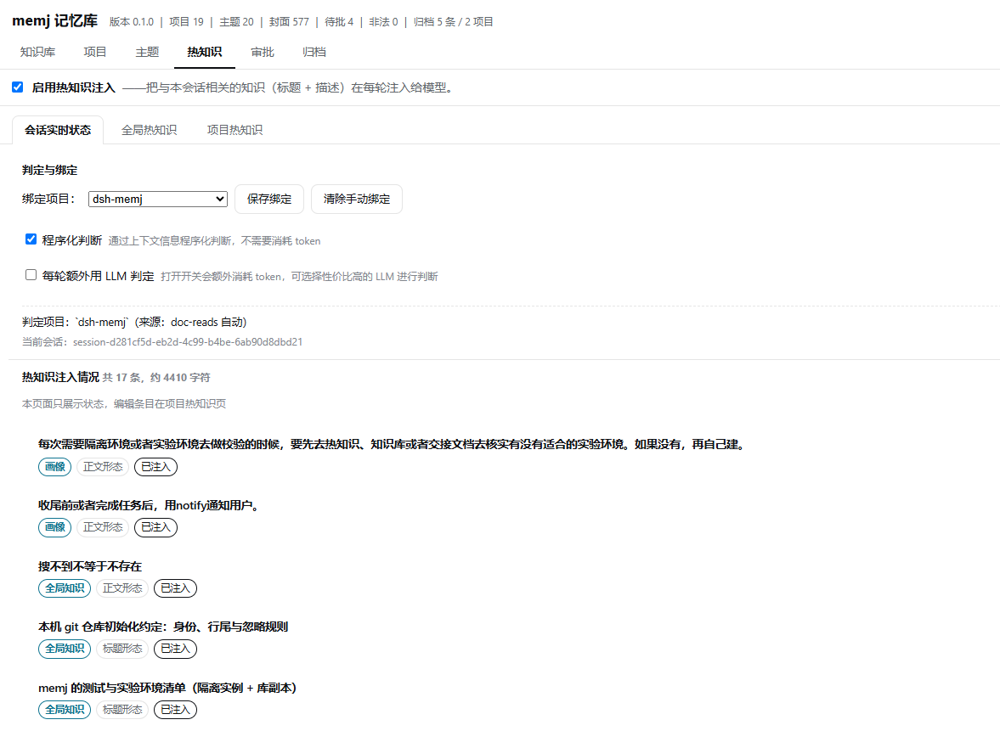

It answers "**why did the model see / not see it**":

- **Detection and binding**: which project this session was judged to be, and **how**
  — the screenshot shows `dsh-memj`, with the source labelled `doc-reads auto`;
  you can also bind manually, or tick "also ask an LLM every turn" (**costs extra tokens**).
- **Hot knowledge injection**: **17 entries / ~4410 characters** this time, each listed with the
  layer it came from (`profile` / `global knowledge` / `project knowledge`), the **shape** it was
  injected in (`title shape` = title + description only; `full-text shape` = the entry's whole
  text), and whether it is **`injected`**.
- ⚠️ This page is **read-only** (edit entries on the "project hot knowledge" page) — it is an
  **acceptance view**, not an editing view.

**② Global hot knowledge — the unconditionally injected part**

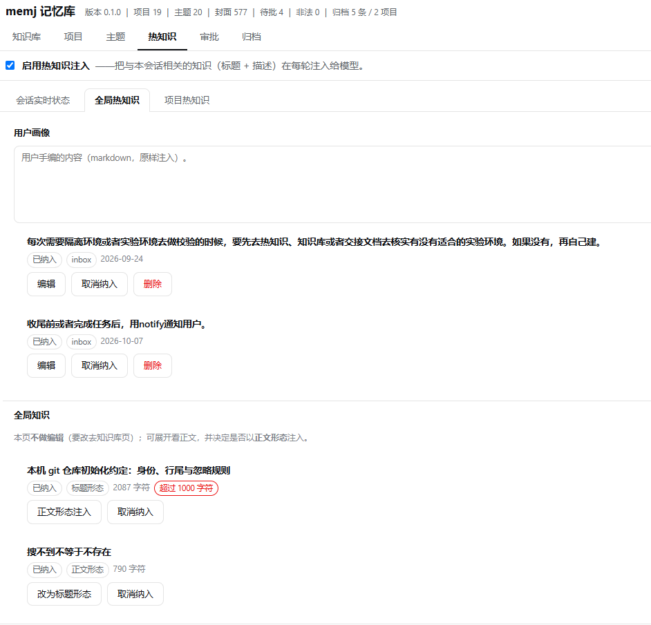

- **User profile**: content you write by hand (Markdown, **injected verbatim**), each item
  offering "edit / stop including / delete".
- **Global knowledge**: the cross-theme entries — this page **does not edit them** (go to the
  knowledge page), so the only buttons are "stop including" and **switching the injection shape**
  (`full-text shape` ↔ `title shape`).
- ⭐ Every item shows its **character count**, and over-budget ones are marked red (the 2087-character
  item above is flagged "over 1000 characters") — because "full-text shape" **injects the whole
  entry**, and one such entry can eat most of the budget.

**③ Project hot knowledge — deciding per project what it should carry**

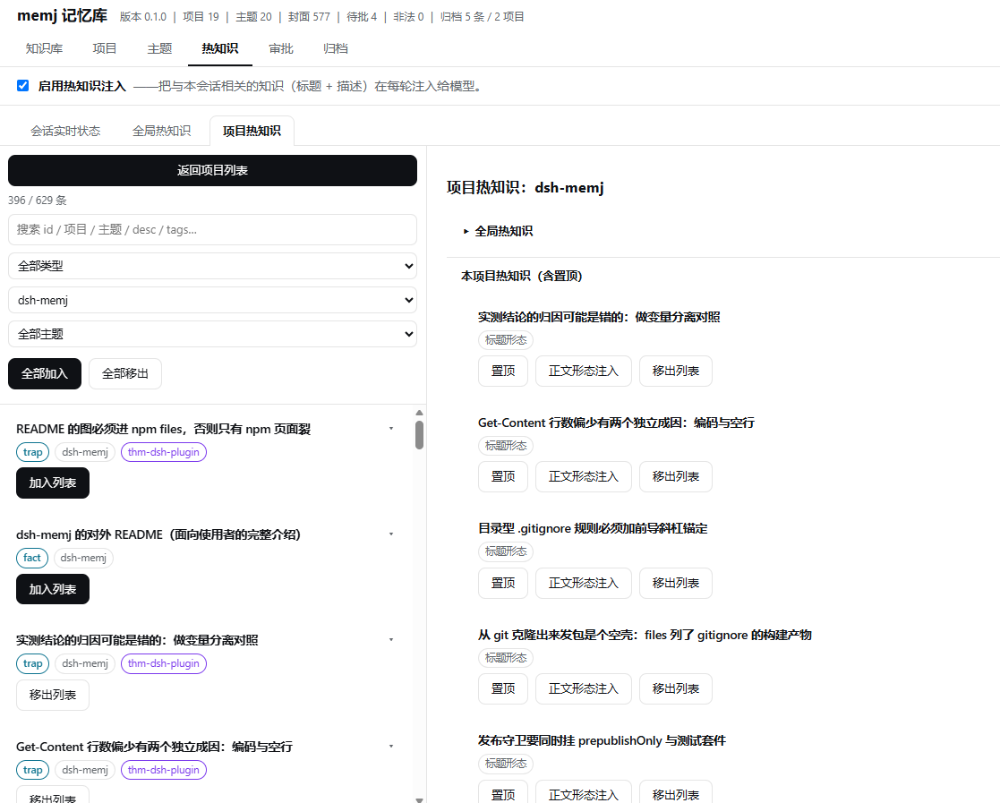

On the left are candidates filtered out of the knowledge base (filter by kind / project / theme,
with "add all / remove all"); click "add to list" to include one. On the right is **the included
list**, where each item can be:

- **pinned** (sorted first, injected with priority);
- switched between **injection shapes** (`title shape` ↔ `full-text shape`);
- removed from the list.

⇒ Together the three views form a "**configure → take effect → verify**" loop:
configure in ②③, it takes effect in the session, and ① lets you **see exactly what got injected**.

### ② End-of-turn scoring — deciding "who gets injected first next time"

At the end of each turn a **subagent** reviews the turn. It does not ask "what was used", but
"**if it had had this knowledge on hand, would it have done better?**" — **finding the knowledge
that should have been given but wasn't**, and scoring it up. Scores are stored per project, and
hot knowledge injection takes the **top N by effective score** (a rolling window, so knowledge
that goes unused gradually drops out).

> ⭐ The value is in **finding the gaps**: scoring knowledge that was already injected is pointless.

### ③ Active injection — fetching knowledge for the model when it didn't think to ask

A **sidecar judge**: after the main model finishes thinking, it decides **whether this step needs
knowledge**, and **what the model is doing**. If the needed knowledge is in the library and the
model hasn't tried to use a tool, the knowledge is **injected into the session directly**.

- **The judge model is configurable**: a **decision model like JEV** is recommended, or a
  **high-throughput model like DS4.1** (also usable with thinking levels off).
- ⚠️ **This is an experimental feature**; how well it works depends heavily on your model and
  scenario — **explore it yourself**.
- Because some decision models (JEV, for instance) **have limited Chinese input support**, there
  is a dedicated **English translation path** paired with a recall index — the translation model
  is configurable.

The three gates (intent / sufficiency / need) plus budget, concurrency, and batching are all
adjustable knobs, and **the evidence for every recall is logged to disk** (`recall-log/`), so you
tune from a real distribution instead of guessing.

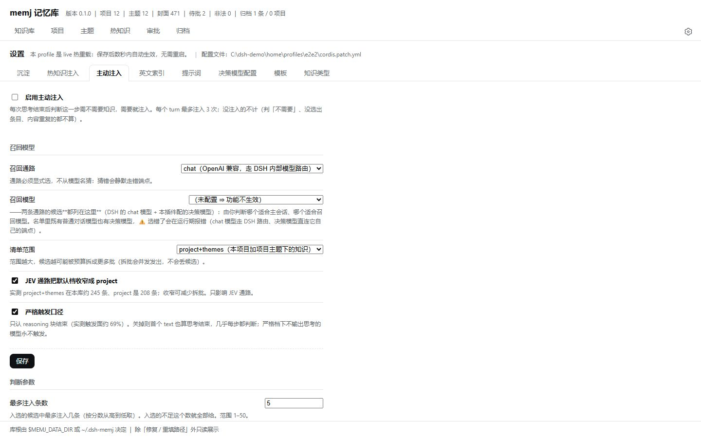

---

## The human-facing panel

**The entry point is at the bottom of the DSH sidebar** — "**memj 记忆库**":


Clicking it opens a **separate browser tab** (`/plugins/dsh-memj/`), so it **doesn't crowd the
session window**, and it **works on narrow screens (phones) too** (two-level navigation plus
collapsible filters) — you can browse the library on your phone without fighting the chat for space.

| Page | What it does |
|---|---|
| **Knowledge base** (知识库) | Search / filter / read full text; edit ownership; jump by id |
| **Projects** (项目) | Full project documents + in-place convention editing + the knowledge and themes they aggregate |
| **Themes** (主题) | The cross-project view of common knowledge |
| **Hot knowledge** (热知识) | Toggles, live session state, per-project lists, global knowledge, user profile |
| **Review** (审批) | Approve / reject global nominations; malformed entries; broken external links |
| **Archive** (归档) | Retire knowledge / projects that are no longer active (restorable any time) — ⚠️ not the same thing as `history` **archiving** above |

The settings page has **8 sub-pages**: Capture (沉淀) · Hot knowledge injection (热知识注入) ·
Active injection (主动注入) · English index (英文索引) · Prompts (提示词) ·
Decision model (决策模型配置) · Templates (模板) · Knowledge types (知识类型).

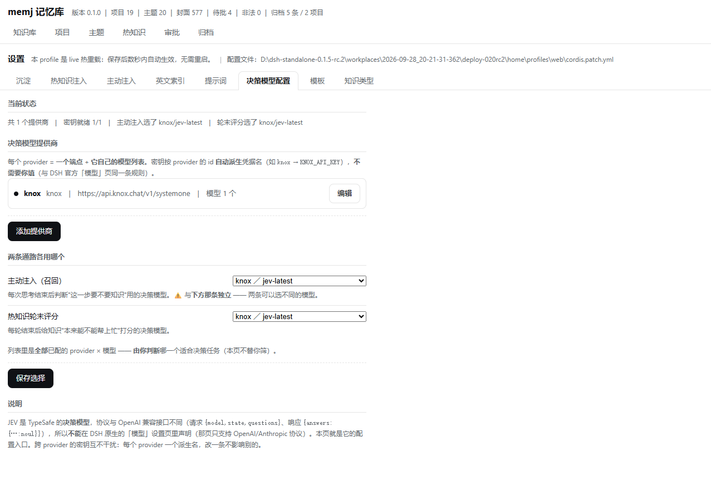

The screenshot above is the "**Decision model**" sub-page — it governs **which model judges** for
the active-injection and end-of-turn-scoring paths.

⭐ **Why it needs its own page**: decision models like JEV do not speak the OpenAI-compatible
protocol (they use `/v1/systemone`, request `{model, state, questions}`, response
`{answers: {...}}`), so they **do not fit in DSH's native "models" settings page** (which only
supports the OpenAI / Anthropic protocols).

- **Multiple providers**: each provider = one endpoint + its own model list;
- Key names are **derived from the provider id** (`knox` → `KNOX_API_KEY`), **you don't type them**;
- The two paths (**active injection** / **end-of-turn scoring**) **choose independently** and may
  use different models;
- ⚠️ Keys are **write-only, never echoed** — the page only shows "keys ready N/M", never a value;
- Each provider's key is **independent**; changing one doesn't affect the others.

---

## Install

The plugin is a **DSH bundle** (`package.json` declares `dsh.bundle.patch`).

### ⚠️ First, check your DSH version

**This plugin requires DSH `>=0.1.5-rc.2 <0.3.0`** (declared in both `engines.dsh` and
`peerDependencies`).

🔴 **Don't install by `latest`** — DSH packages on npm are:

| dist-tag | Version | Usable? |
|---|---|---|
| `latest` | `0.1.0-rc.6` | ❌ **Too old** |
| **`next`** | **`0.2.0-rc.2`** | ✅ **Use this** |
| `alpha` | `0.2.1-alpha.2` | ✅ Also fine |

⇒ When installing DSH, **add `@next`**:

```bash
pnpm add @deepseek-ai/dsh-agent@next    # not @latest
```

⭐ A one-liner to check what you have installed:

```bash
node -p "require('@deepseek-ai/dsh-tools/package.json').version"
```

### Install from the DSH UI (recommended)

⭐ **Plugins** page in the left sidebar → **"Add plugin"** in the top right → type **`dsh-memj`**
→ **Install**.


- **No commands, no restart**: a few seconds after installing, the sidebar entry and
  `/plugins/dsh-memj/*` are ready;
- **Install source** is your choice depending on your network (a mirror works in mainland China);
- **Upgrading is the same**: type `dsh-memj@<version>` in the box (why: see "Upgrading: include the
  version" below).

### Regular install (CLI / npm)

**Package page: <https://www.npmjs.com/package/dsh-memj>**

```bash
dsh plugin --profile web add dsh-memj
```

> `pnpm add dsh-memj` is equivalent; what `dsh plugin add` adds on top is the two automatic
> registrations described below.

**One command is enough** — it will: ① run pnpm inside the profile directory and add it to
`dependencies`; ② notice the package declares `dsh.bundle` and **automatically** add `dsh-memj`
to `dsh.profile.bundles`; ③ load it immediately.

⭐ **Measured (fresh home + fresh profile + real tarball)**:
the command **exits 0** and **both manifests are written correctly** (no hand-editing
`package.json`, no hand-making junctions);
⭐ **it takes effect without a restart** — installed on a **running** instance, the sidebar entry
and `/plugins/dsh-memj/*` were fully available after about **6 seconds** (process start time
unchanged, which proves **no restart** happened).
Even simpler: install from the DSH UI's plugin management page — likewise no restart needed.

⚠️ **Use your own profile name**: the default is `web`, but it can also be `tui` / `headless` /
one you created yourself.

#### ⚠️ Upgrading: include the version

```bash
dsh plugin --profile web add dsh-memj@0.1.5     # ✅ ask for this version explicitly
```

🔴 **Writing just the package name (`add dsh-memj`) can leave you on an old version**: pnpm
prefers to reuse whatever version the profile's `pnpm-lock.yaml` has already pinned — and as long
as it satisfies the range in `package.json` (e.g. `^0.1.0`), pnpm considers it "already installed"
and **never looks at npm for a newer one**.
⚠️ **This is not a problem with the npm package or the GitHub repo**: a fresh environment (no lock
file) installs `latest`; only **machines that already installed an older version** get pinned by
their own lock file.
(In the UI, just type `dsh-memj@<version>` in the box.)
⭐ The lock file itself is a **good thing** — don't delete it by hand: it also pins the tarball's
`integrity` hash (protecting against same-name-same-version content swaps).

### Install straight from GitHub (bypassing npm)

`lib/` build output is committed ⇒ **the repository can be installed directly** (no local build
needed):

```bash
dsh plugin --profile web add https://github.com/jojoman2024/dsh-memj
```

⭐ This is exactly why this repo **deliberately commits `lib/`** — most DSH plugin repos in the
ecosystem do the same.
⚠️ But **prefer the npm route day to day**: it has a traceable version number, and the `files`
allowlist guarantees the package contains only what's needed at runtime (`node_modules` /
`scripts` / `src` and friends are not installed).

### Installing for development (local source)

When editing source, use `link:` so the workspace copy is what runs:

```json
{
  "dependencies": { "dsh-memj": "link:D:/.../adapt-memj" },
  "dsh": { "profile": { "bundles": ["...", "dsh-memj"] } }
}
```

⚠️ On this path **you must do the three steps `dsh plugin ... add` would have done yourself**:
create a junction in `node_modules` pointing at the plugin directory, and add a line to the
`bundles` array by hand. **Missing either only means "not loaded" — it never errors.**

### `cordis.patch.yml` (the one shipped in the package)

🔴 **`dsh.bundle.patch` is mandatory**: `package.json` declares it, and a missing file
**hard-fails at profile load time** (`dsh-app-boot` throws while reading the overlay).

```yaml
# cordis.patch.yml
- insert:
    - id: memj
      name: dsh-memj
```

⚠️ **It only handles "mount the plugin into the profile"** — this plugin has **both a host and a
client half** (tools / protocol / commands / routes on the host; the sidebar entry and the
`/memj-review` dialog on the client), and **the client manifest is `package.json`'s `dsh.client`,
not this file**.

⭐ **The `id` is `memj`, not the package name `dsh-memj`** — the settings panel writes
`- id: <that value>` config overrides into the profile's patch, and **a wrong id fails very
quietly**: boot prints only a one-line warning (`patch: entry "dsh-memj" not found`), the config
**silently does nothing**, and the panel still says "saved".

---

## What the library looks like

```
~/.dsh-memj/                        ← the whole library = one directory; copy it and you've migrated
├─ projects/HANDOFF-<project>.md    ← project documents: [the single write source] (narrative + index)
├─ entries/<slug>-<uuid8>.md        ← full text (one document per entry)
├─ themes/THEME-<id>.md             ← theme layer: derived (hand edits are overwritten by rebuild)
├─ GLOBAL.md                        ← global layer: derived
├─ reads/session-<id>.jsonl         ← read snapshots (cross-project evidence)
├─ doc-reads/session-<id>.jsonl     ← project document read log
├─ recall-log/  score-log/          ← two append-only jsonl logs
├─ hot/                             ← hot knowledge: profile / per-item settings / per-project lists /
│                                     session bindings / score table
├─ tags/vocabulary.json             ← tag vocabulary
├─ prompts/overrides.json           ← ⭐ prompt overrides (the single runtime source)
├─ templates/<id>.md                ← project document templates
├─ kinds.md                         ← knowledge type vocabulary
├─ nominations.json                 ← pending global nominations
├─ backup/                          ← full-text mirror + its own git repository
├─ recall/en-index.json             ← English recall index
└─ .startup-diag.txt                ← startup diagnostics (first-hand evidence when troubleshooting)
```

**The library root can be overridden with `MEMJ_DATA_DIR`** (a blank env var counts as unset).

⚠️ **When measuring the library's size, `Get-ChildItem -Recurse` needs `-Force`**:
`backup/.git/` is a hidden directory, and without it the walk silently skips it ⇒ you get a number
that is **43% too small**.

### Three kinds of data (be sure to tell them apart)

| | Pure projections (derived) | Accumulated judgment (source) | User data |
|---|---|---|---|
| Examples | `themes/` · `GLOBAL.md` · `recall/en-index.json` | `tags/vocabulary.json` · `hot/scores.json` | `prompts/` · `templates/` · `kinds.md` |
| If lost | Rebuild and it's back | 🔴 **Gone forever** | Reconfigure by hand |
| Maintenance | **Full rebuild + diff** | ⚠️ **Reconcile incrementally only, never rebuild** | Travels with the library |

🔴 **The biggest trap here**: applying the `en-index` "rebuild" logic to
`tags/vocabulary.json` **silently erases every accumulated ruling** — and it looks like it
"fixed" things (right count, right structure, just the judgment gone).

---

## Configuration

Configuration lives in the profile's `cordis.patch.yml` (the `config` of the `- id: memj`
entry), or you can **just use the human-side settings page** (it writes the same file).

**78 config keys**, in 8 groups by function: **reading / capture / hot knowledge / knowledge
scoring / English index / tag normalization / active injection / JEV**. Every item in the settings
page carries a "after saving" line explaining how it takes effect
(`✅ takes effect immediately (no restart)` or `⚠️ requires an instance restart`).

⚠️ **Three master switches default to off** (`hotInject` / `hotScoreOnTurnEnd` / `activeInject`),
consistent with memj's standing posture: **the plugin does not push, the model looks things up**;
injection only happens once you explicitly turn it on.
While off, **not a single listener is attached** (zero overhead, and it doesn't appear in the
event chain at all) — the diagnostic line honestly distinguishes `xxx-registered` from
`xxx-skipped(disabled)`.

⚠️ **Settings are saved per *block*, not per page** — each block has its own save button and
result line.

### Decision model (JEV) configuration

JEV is not an OpenAI-compatible protocol (it uses `/v1/systemone`), and DSH's native "models"
settings page can't hold it ⇒ the plugin ships its own **"Decision model" sub-page** with
**multi-provider** support, where keys are **write-only** (stored in the credential seam; the UI
ever only shows "configured").

---

## Boundaries and known limitations

- **No vector retrieval / rerank**: retrieval is whole-word `includes` plus weighted accumulation
  (the model distills the query terms).
  ⚠️ Consequently there is **no secondary tokenization** (meaningless fragments can never be
  conjured out of thin air).
- **No multi-instance isolation**: one library serves every instance. ⚠️ Two instances scoring the
  same project simultaneously can lose updates (the score table's mutex is **per process**) —
  fine for single-user single-instance; a known boundary.
- **Broken external references are not auto-repaired**: it reports them and offers a "re-enter the
  path" entry, but **never guesses a path**.
- **It does not migrate existing `HANDOFF-*.md` files in your workspace.**
- **Active injection is experimental**: results depend heavily on the decision model you choose;
  tune it yourself.
- **Library files are read and written directly via `node:fs`**: the plugin's own API assumes
  "loopback plus a port you opened yourself" — ⚠️ **do not expose it to the public internet**.

---

## Development

```bash
pnpm run build      # tsdown (host + client entries) → copy-web → artifact self-check → prompt ledger check
pnpm run typecheck  # tsc (src) + tsc (src/client)
pnpm run test       # 52 suites
pnpm run check      # all three above
```

🔴 **Don't assemble the build command line yourself**: `tsdown.config.ts` exports an **array** (two
entries), so it prints `Build complete` **twice**; truncating the output with a pipe **kills the
upstream process** ⇒ `lib/` ends up with only `client.js`. Use `scripts/build.mjs` — it pins the
order and runs an artifact self-check.

⚠️ **`run-all-tests.mjs` uses `spawnSync(stdio:'pipe')`**: in an environment **where pipes are
restricted** (some sandboxes), it reports **every suite red with empty failure details**. That is
an environment problem, not a regression.

### Mounting and taking effect

| What changed | How it takes effect |
|---|---|
| `src/web/*` (front-end static assets) | **Just refresh the page** (read from disk on every request) |
| `src/*.ts` (host half) | 🔴 **An instance restart is required** (imported at startup, never re-read) |
| Any text in the Prompts settings page | **Takes effect immediately** (command descriptions excepted — those need a restart) |
| `cordis.patch.yml` config | Depends on the profile's `patchReload`: `live` ⇒ **hot reload**; `startup` ⇒ restart (unset = `live`) |

⚠️ **After `pnpm run build` you must restart** for a running instance to pick it up.
⭐ **"The front end updated on refresh while the API stayed old"** is intentional (static files are
read from disk every request) — don't use it to conclude "the build took effect".

### Implementation notes (read before changing code)

- **Library reads/writes must use `node:fs`, not `ctx.fs`**: the latter is governed by
  `DSH_PERMISSION_MODE` / `sandboxPolicy`, and under the default `workspace-write` the writable
  roots are only the workspace and tmp — while the library is at `~/.dsh-memj/` ⇒ it would be
  rejected with `FS_SANDBOX_DENIED`.
- **With `ctx.inject(['systemPrompt','tools','commands'], cb)`, a missing service means the
  callback never runs and nothing errors** — the symptom is "the plugin loaded but there are no
  tools or commands at all". Hence the startup diagnostics in `.startup-diag.txt`.
- 🔴 **Routes in `api.ts` must be registered one by one in `index.ts`**: miss one ⇒ the request
  falls through to the SPA fallback and returns **HTML** instead of JSON, the front end's
  `JSON.parse` throws, and **the server shows nothing unusual**.
- ⭐ **One fact, one implementation**: `paths` / `store` / `parse` / `prompts` / `sections` /
  `edit` — **any newly added "second maintenance path" must come with a check that can go red.**
- **`source.kind` is `plugin:dsh-memj`** (there has been no catch-all `plugin` since 0.2.0).
- **When writing prompts for the model, never put runtime numbers into resident text** (that
  would make the prefix cache miss forever).
- 🔴 **Before changing something that "looks like a bug", confirm it isn't covering for something
  else** — a real example: the knowledge type `enum` gets evaluated into a static value by
  `{ ...kindParam(...) }`, which looks like "the getter stopped working"; **but it happens to
  satisfy DSH's requirement that parameters be static data records** ⇒ treating it as a bug and
  restoring the getter **fails registration for 4 tools outright**.
  ⭐ The test: **"it registers" ≠ "the design is right"** — the same bug can be holding both up.

---

## Releasing (for maintainers)

```bash
pnpm publish        # prepublishOnly = build + publish gate; both must pass to publish
```

🔴🔴 **`lib/` is build output, excluded by `.gitignore`, and `files` must list it** — both of
those are correct, and **the mistake is that nothing guards the gap between them**:

> **Running `npm pack` directly in a repo cloned from git produces a hollow package**
> (only `LICENSE` / `README.md` / `cordis.patch.yml` / `package.json`, **no `lib/`**),
> and npm **does not error** — it simply **skips** paths in `files` that don't exist.
> ⚠️ The output still shows name / version / shasum, **looking entirely normal**.

⭐ The test: **assert on the artifact, not the configuration.** So `scripts/check-pack.mjs`
**actually packs** (`npm pack --dry-run --json`) and then asserts that `lib/index.js` /
`lib/client.js` are really in there, **without reading the `files` field**; screenshots referenced
by the README are asserted too (otherwise **every image breaks on npm while GitHub looks fine**).
It is hooked into both `prepublishOnly` and the test suite (the former guarantees it passes at
publish time, the latter guarantees it **goes red in ordinary development**).

## License

MIT
